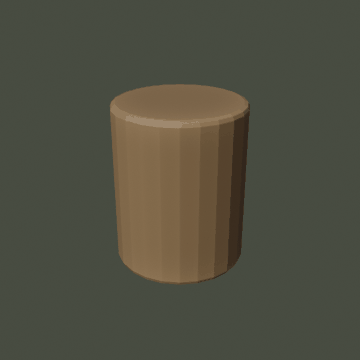

# ai-gamedev-orchestrator

Orchestrateur **LangGraph** de production d'assets de jeu : il parle **MCP** à deux serveurs qui pilotent de vrais logiciels.

```
brief ─► generate (Blender, via MCP) ─► validate ──ok──► import_engine (Unreal, via MCP) ─► rapport
                ▲                          │
                └──── fix_name ◄───────────┤ nom non conforme : corrigé automatiquement (max 3 tentatives)
                                           └─ autre erreur (budget de triangles, UV…) : asset REJETÉ, jamais importé
```

| Brique | Rôle |
|---|---|
| [blender-mcp-pipeline](https://github.com/Chaams/blender-mcp-pipeline) | génère le prop (UV, échelle appliquée, FBX) |
| [game-asset-validator](https://github.com/Chaams/game-asset-validator) | valide nommage, budget, UV, textures |
| [unreal-mcp-bridge](https://github.com/Chaams/unreal-mcp-bridge) | importe le FBX dans le projet Unreal |

Le graphe ne dépend que de l'interface `GameTools` : `McpTools` parle vraiment MCP (client stdio) ;
les tests utilisent des outils factices.

## Démo (exécution réelle)

```text
$ python -m src.run --kind barrel --name "oil barrel" --profile mobile --project Jeu.uproject
SM_OilBarrel : importé dans Unreal (/Game/Props/SM_OilBarrel.SM_OilBarrel) après 2 tentative(s).
(durée : 64 s — Blender 4.1 + Unreal Engine 5.4, via MCP)
```

Le nom « oil barrel » est refusé par la validation (préfixe manquant), corrigé automatiquement en `SM_OilBarrel`,
régénéré par Blender, puis importé par Unreal. L'asset obtenu, rendu par `render_turntable` :



*Unreal tourne sans affichage (`-nullrhi`) : la preuve de l'import est le journal ci-dessus (`docs/demo-run.txt`), pas une capture de l'éditeur.*

## Utiliser

```bash
# les trois dépôts voisins dans le même dossier : blender-mcp-pipeline, unreal-mcp-bridge, ai-gamedev-orchestrator
pip install -r requirements.txt
pytest -v                 # 10 tests rapides (outils factices) + 1 test de bout en bout réel
python -m src.run --kind barrel --name "oil barrel" --profile mobile --project C:\Jeu\Jeu.uproject
```

Variables facultatives : `BLENDER_MCP_DIR`, `UNREAL_MCP_DIR` (emplacement des serveurs), `BLENDER_PATH`, `UE_ROOT`.

## Ce qui est testé
- **Rapide, partout** : naming, boucle de correction bornée, rejet sans import, UV manquantes non corrigeables.
- **Réel (ignoré si Blender/Unreal sont absents)** : « oil barrel » → corrigé en `SM_OilBarrel` → généré par Blender →
  importé par Unreal comme `/Game/Props/SM_OilBarrel` (≈ 30 s, Blender 4.1 + Unreal Engine 5.4).
